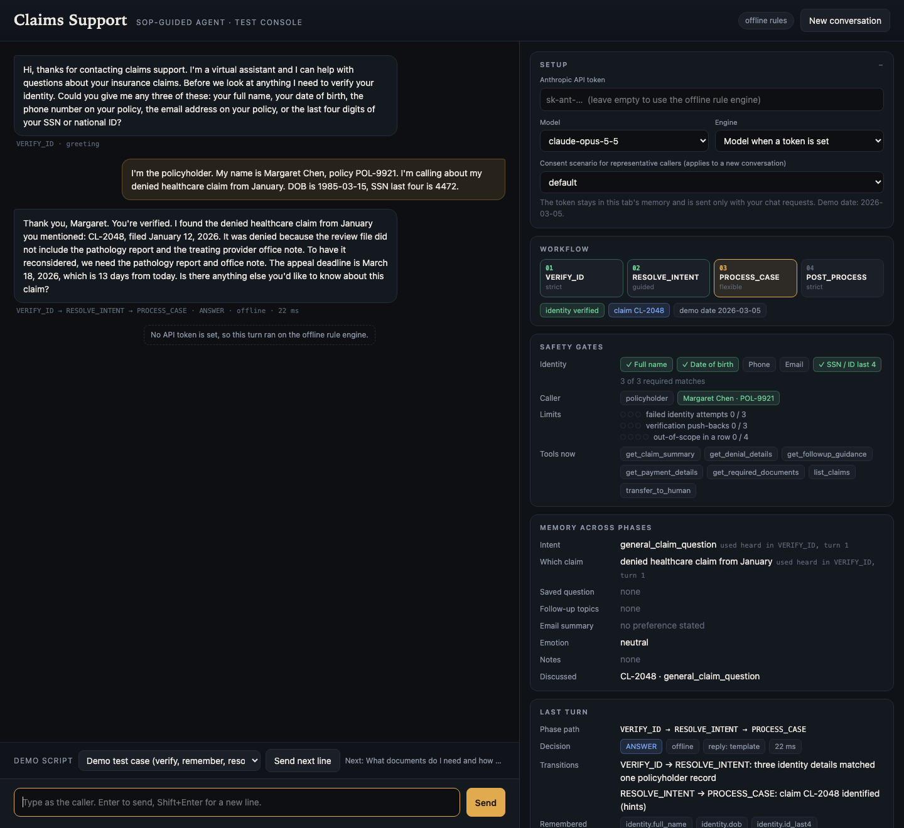

# SOP-Guided Conversational Agent

An insurance claims support agent that follows a fixed business workflow and still talks like a person.

```
VERIFY_ID  ->  RESOLVE_INTENT  ->  PROCESS_CASE  ->  POST_PROCESS
 strict          guided             flexible          strict
```

The workflow is code. A language model reads what the caller said and words the reply. It never decides a phase change, never calls a tool, and never receives claim data before the caller is verified.



## Quick start

```bash
git clone <this repository> && cd sop-guided-conversational-agent
```

### Docker

```bash
docker build -t sop-agent .
docker run --rm -p 8000:8000 -e ANTHROPIC_API_KEY=sk-ant-... sop-agent
# or: ANTHROPIC_API_KEY=sk-ant-... docker compose up --build
```

Open http://localhost:8000.

### Python 3.11 or newer (tested on 3.12)

```bash
python3 -m venv .venv
.venv/bin/pip install -r requirements.txt
ANTHROPIC_API_KEY=sk-ant-... .venv/bin/uvicorn server.app:app --port 8000
```

Open http://localhost:8000. Leave `ANTHROPIC_API_KEY` out to start without a token.

### The API token

The agent calls Claude through the Anthropic API. Give it a token in any of three ways:

- set `ANTHROPIC_API_KEY` when you start the server
- copy `.env.example` to `.env` and put the token there. The server and `docker compose` both read it, and `.env` is ignored by git
- paste the token into **Setup** in the UI. It stays in that browser tab's memory, travels in the `X-API-Key` header of your chat requests, and is never written to disk or to a log

The default model is `claude-opus-5-5` at low effort. Each turn makes two model calls (understand, then phrase), which takes about 5 seconds and costs about 2 cents. Pick another model in the UI or with `SOP_MODEL`. `claude-haiku-5-5` answers in about 2 seconds for a small fraction of a cent.

### No token

Everything also runs without a token. Leave the field empty and the agent uses its offline engine: rule-based understanding and template replies, driven by the same SOP policy. This is how the test suite runs. It handles common phrasings, which is narrower than what the model handles. It is built to fail safe: an email, a transfer, a change of claim or a counted identity attempt is read only from unambiguous wording, and an unclear message is asked about again.

## Try it

The UI has a **Demo script** menu. Pick a script and press **Send next line** to step through it, or type freely.

| Script | What it shows |
|---|---|
| Demo test case | Identity extracted and verified, the "denied healthcare claim from January" hint remembered and used, grounded answer, email summary |
| Bonus: frustrated caller | Empathy first, the reason for verification, allowed options, no disclosure, then the saved question answered once verified |
| Bonus: refusal | Two rounds of persuasion, then a hand-off to a human with a context ticket |
| Out-of-scope questions | Polite decline, offer of a human on the third, transfer on the fourth |
| Representative caller | Listing check and policyholder consent as extra gates |
| Memory | A claim hint and an email preference given before verification, used later |
| Ambiguous claim | Disambiguation, then switching to a second claim |

A link such as `/?script=1&auto=1` plays a script on load. `&turns=2` stops after two lines.

The same scenarios run in a terminal, offline:

```bash
.venv/bin/python scripts/demo.py            # all scenarios
.venv/bin/python scripts/demo.py bonus      # one of: happy bonus refusal scope representative memory ambiguous
```

### Test data

| Policyholder | Policy | Date of birth | Phone | Email | ID last 4 | Claims |
|---|---|---|---|---|---|---|
| Margaret Chen | POL-9921 | 1985-03-15 | 650-521-2836 | margaret@email.com | 4472 | CL-2048 healthcare, denied (Jan 2026). CL-2011 healthcare, closed (Jan 2025). CL-1899 dental, closed (Nov 2025). CL-2102 auto, open (Feb 2026) |
| Ma Tian | POL-8836 | 1964-09-10 | 650-208-8799 | matian@example.com | 6688 | CL-3001 healthcare, denied (Mar 2026) |
| Ava Lopez | POL-1044 | 1990-08-21 | 650-388-2920 | ava.lopez@email.com | 9180 | none |
| Ya Wen Li | POL-7742 | 1989-12-03 | 650-521-2830 | yawen.li@gmail.com | 5317 | none |

David Chen is listed as Margaret Chen's authorized representative. The fixtures are dated early 2026, so the demo clock is fixed at 2026-03-05 (set `SOP_TODAY` to change it).

### The demo test case

> I'm the policyholder. My name is Margaret Chen, policy POL-9921. I'm calling about my denied healthcare claim from January. DOB is 1985-03-15, SSN last four is 4472.

| Expected | What happens | Where to see it |
|---|---|---|
| Extracts identity and verifies | Name, date of birth and SSN last four match one record. Three of five is the rule. The policy number helps find the record and does not count as one of the three | Safety gates panel |
| No claim detail before verification | Until the gate opens, no claim tool is allowed and the reply writer receives no claim data | "Facts the reply was allowed to use" in the Last turn panel |
| Remembers the hint | Intent and "denied healthcare claim from January" are stored while still in VERIFY_ID | Memory panel, tagged with the phase and turn where it was heard |
| Uses the hint after verification | RESOLVE_INTENT filters Margaret's four claims down to CL-2048 without asking | Phase path `VERIFY_ID -> RESOLVE_INTENT -> PROCESS_CASE`, and "Memory used" |
| Grounded answer | Denial reason, documents and appeal deadline come from tool results | Tools list and facts in the Last turn panel |

## How it works

### One turn

```
caller text
   |  full SSNs are redacted before anything is stored or sent
   v
1. UNDERSTAND   model with a JSON schema, or offline rules        -> Understanding
   v
2. DECIDE       SOP policy, plain code                            -> Directive
                memory, gates, tools, counters, transitions
   v
3. PHRASE       model writes the reply from the directive's facts (or the template is used)
   v
4. GUARD        code checks the reply and falls back to the template on any violation
   v
reply
```

The `Understanding` is a fixed structure: scope, caller role, identity values, intent, hints about which claim, emotion, yes or no, and so on. The `Directive` is what the SOP decided: a goal, the points to cover, the rules for this turn, and the complete set of facts the reply may use. It also carries a deterministic reply that satisfies it. That reply is used verbatim in offline mode and whenever the guard rejects what the model wrote.

### Who decides what

| Decision | Decided by |
|---|---|
| What the caller said: intent, identity values, emotion, scope | Model, constrained by a schema, then normalised in code |
| Whether identity is verified | Code. Three of five details must match one record. A wrong value is a failed attempt and is discarded, and three failed attempts hand the caller to a person |
| Phase changes | Code. A phase graph with entry gates |
| Which claim and which workflow path | Model proposes, code validates against the caller's own claims |
| Which tools run | Code. The path fixes the tools, and each tool is limited to certain phases |
| What facts a reply may contain | Code. Tool results for this turn only |
| Wording, empathy, answering the specific question | Model |
| Whether the reply is released | Code. The output guard |

### Different freedom in each phase

| Phase | The model is free to | Enforced in code |
|---|---|---|
| VERIFY_ID (strict) | Talk naturally, answer "why do you need this", "which three?" or "can I use my address instead?", handle partial answers, refusals and alternate identity fields | No claim tool is allowed in this phase, so no claim data exists in the turn. The gate opens in one function, on three matching details |
| RESOLVE_INTENT (guided) | Turn messy language into one of six intents and a choice of claim | The choice must be one of the verified caller's claims. Ambiguity leads to a question, a mismatch to a list of what is on file |
| PROCESS_CASE (flexible) | Answer follow-up questions in its own words, from the facts | The intent picks a path, the path picks the tools. A message that asks two things takes both paths. Every claim number, amount and date in the reply must appear in the facts. A request no path covers gets an offer of a human representative |
| POST_PROCESS (strict) | Word the offer and the goodbye | The email goes out only on an explicit choice, only to the address on file, and its content is composed in code |

Non-disclosure before verification does not depend on the model following an instruction. The data is not in the prompt. `tests/test_llm_path.py` asserts this on the exact text sent to the model.

### Memory across phases

Every turn fills memory slots whatever the current phase: identity values, role, intent, claim hints, the question asked, follow-up topics, the email preference, and free-form notes. A slot that belongs to a later phase waits there. The inspector shows where each slot was heard ("heard in VERIFY_ID, turn 1") and when it was used.

Examples: a caller who says "it's about my auto claim, and email me a summary at the end" during verification is taken straight to the auto claim once verified, and is later asked to confirm the summary they already requested. A second question asked while the first is still waiting is added to it, and both are answered after verification.

### Scope

Each message is read as in scope, out of scope or mixed. Out-of-scope requests ("What is RL?") are declined politely, in fixed wording, and the caller is steered back to the current step. The phase does not change. When the count reaches three the agent offers a human representative, and at four it transfers. A relevant message takes one off the count. It does not reset it, so slipping one relevant line between unrelated questions does not start the count again.

A question about the step itself is in scope: before verification, "what do you mean?" or "what happens if I get it wrong?" is answered and never counted.

### Emotional support and SOP recovery (bonus)

- The understanding step labels each message as neutral, frustrated, angry, anxious, confused or sad. A non-neutral label puts tone guidance in the directive and the reply opens with one acknowledgement.
- Pushback on verification gets empathy, the reason for the step, credit for details already given, and the remaining options. Nothing is disclosed and the gate stays closed.
- A second pushback adds the offer of a human representative. A third stops the persuasion and transfers.
- "I don't have my SSN on me" is treated as a declined field. The agent offers the other fields.
- Giving details while upset counts as progress.
- A clear request for a human is honoured immediately in any phase. Mentioning a person ("was this decided by an actual person?") or saying "don't transfer me" is not a request.
- After verification, a confused caller who asks nothing specific gets the explanation again and is asked which part to go over. An upset caller who asks nothing is asked what was missed, and after three such turns is asked whether they would like a person.
- Every transfer creates a ticket with what is known so far, so the caller does not repeat themselves. The ticket states whether identity was verified.

For the example in the brief ("I already told you who I am. This is ridiculous. Just tell me why my claim was denied."), said by a caller who has so far given only a name, the offline engine answers:

> I understand you're upset, and I'm sorry for the trouble this has caused you. You're right that you've given me your full name, thank you. Your claim file holds private health and financial information, so I have to confirm it's really you before I can share anything from it, including the reason for a decision. It only takes a moment. I need two more details to finish. You can choose from your date of birth, the phone number on your policy, the email address on your policy, or the last four digits of your SSN or national ID.

The question about the denial is saved and answered as soon as verification completes.

### Representative callers and consent

Someone calling for a policyholder has to pass three checks: the policyholder's details match, the caller is listed as an authorized representative, and the policyholder approves a consent request. The consent status comes from `consent_scenarios.json` (choose `default` or `timeout` in the UI before starting a conversation). Until consent is approved the session stays in VERIFY_ID. A request that expires is not sent again: the caller is offered a person, and then handed to one.

This gate depends on what the caller says about themselves ("I'm her husband", "I'm calling for Margaret Chen"). Someone who presents three correct details as their own is treated as the policyholder, as the three-detail rule says. A caller verified as the policyholder who later says they are acting for someone else is handed to a person.

### Output guard

The first protection is structural: the model is given no record data before verification, and only the tool results of the current path after it. The guard is a second check on what the model wrote. A reply is released only if:

- every claim number, policy number, email address, phone number, dollar amount, date and count of days in it is grounded. Grounded means it appears in this turn's facts, was said by the caller, or was in the facts of an earlier turn after verification. An amount may also be the sum or difference of two grounded amounts
- it contains no value held only in the records (identity numbers, other people's names, denial reasons, requested documents)
- before verification, it does not say the caller is verified, that it can see a record, or what the status of a claim is
- it does not say that something was sent or that a transfer happened unless the workflow did that in this turn
- it does not promise an outcome ("it will be approved") or offer an action the assistant cannot take ("I can expedite that")

Otherwise the deterministic reply is sent and the rejection is shown in the inspector. The guard works on patterns. It covers the usual ways of writing these things, not every possible paraphrase, which is why it is the second line and not the first.

## Configuration

| Variable | Default | Meaning |
|---|---|---|
| `ANTHROPIC_API_KEY` | unset | Token used when the browser does not send one |
| `SOP_MODEL` | `claude-opus-5-5` | Default model |
| `SOP_EFFORT` | `low` | Reasoning effort for both calls |
| `SOP_TODAY` | `2026-03-05` | Demo clock. A date, or `real` for the system date |
| `SOP_INSPECTOR` | `on` | `off` removes harness internals from API responses |
| `PORT` | `8000` | Port inside the container |

SOP limits live in `apps/insurance_claims/sop/common.py`: three failed identity attempts, three names that match no policy before a name counts as a failed attempt, two rounds of persuasion, a human offered at three out-of-scope messages and a transfer at four. One caller message is at most 2000 characters.

## Project layout

```
sop_harness/                 domain-agnostic harness
  core.py                    phase graph with gates, phase-gated tool registry, Directive, TurnTrace
  llm.py                     Anthropic client (structured output, refusal handling), scripted stand-in
apps/insurance_claims/
  agent.py                   the turn pipeline
  sop/workflow.py            phase graph, per-turn loop, cross-phase memory
  sop/verify_id.py           phase 1
  sop/resolve_intent.py      phase 2
  sop/process_case.py        phase 3 and the workflow paths
  sop/post_process.py        phase 4
  sop/common.py              limits, wording, hand-off, scope control
  state.py                   session state and the memory slots
  data.py                    read-only access to the sample records
  verification.py            three-of-five identity matching
  normalize.py               names, dates, phone numbers, SSN redaction
  tools.py                   claim, consent, email and hand-off tools
  guidance.py                document follow-up guidance from the fixtures
  understanding.py           the Understanding structure and its JSON schema
  nlu_llm.py, nlg.py         prompts for the two model calls
  nlu_rules.py               offline understanding
  guard.py                   output guard
  email_summary.py           summary composer
  fixtures/                  sample data
server/app.py                FastAPI app
server/static/index.html     test UI
scripts/demo.py              scripted conversations in the terminal, offline
scripts/live_check.py        the same conversations against the real model, with a spending cap
tests/                       410 tests, all offline
```

## Tests

```bash
.venv/bin/pip install -r requirements-dev.txt
.venv/bin/pytest
```

The suite is offline. It never reads `.env` and removes any token from the environment, so it cannot spend money.

The suite covers the demo case, the verification gate, the bonus scenarios, scope control, claim resolution, the workflow paths, the email step, representative consent, harness enforcement (tool gating, illegal transitions), the output guard against leaking or overclaiming model replies, and the shape of the request sent to the Anthropic API. `tests/test_review_findings.py` holds one regression test for each problem found by the code review before submission. `ruff check .` passes with the configuration in `ruff.toml`.

## Checked against the live model

`scripts/live_check.py` runs scripted conversations against the real API with a spending cap, and checks the workflow outcome of every turn (phase, verification, claim chosen, email sent, nothing protected said before verification). Those checks hold whatever wording the model chooses.

```bash
.venv/bin/python scripts/live_check.py --ping                          # one tiny call to check the token
.venv/bin/python scripts/live_check.py --scenarios happy,bonus         # capped at $0.50 by default
.venv/bin/python scripts/live_check.py --scenarios all --model claude-haiku-5-5 --max-usd 0.10
.venv/bin/python scripts/live_check.py --offline --scenarios all       # the same outcome checks on the offline engine, free
```

Ten scenarios are included: the seven demo scripts plus three that only a model can follow (spoken-style language such as "bday is march fifteenth nineteen eighty five", prompt injection before verification, and an anxious caller with a missing document).

Results on 2026-11-19, before the last round of review fixes:

| Model | Turns | Outcome checks | Replies written by the model | Median time per turn | Cost per turn |
|---|---|---|---|---|---|
| `claude-opus-5-5` (default) | 61 | all passed | 61 of 61 | 4.6 s | about $0.02 |
| `claude-sonnet-5-5` | 12 | all passed | 12 of 12 | 4.0 s | about $0.01 |
| `claude-haiku-5-5` | 53 | all passed | 51 of 53 | 2.1 s | under $0.001 |
| `claude-fable-5-2` | 1 | passed | 1 of 1 | 4.9 s | about $0.08 |

The two Haiku replies that were not used had been rejected by the output guard for wording that was in fact correct. Both guard rules were corrected and are covered by `tests/test_regressions.py`, along with the other problems the live runs exposed.

The last round of review fixes came after these runs. It added two fields to the understanding schema, extended the understanding prompt and widened the output guard. On the final version the outcome checks of the seven scripted scenarios pass on the offline engine (`--offline`, also run by the test suite), and the model path is covered by the scripted tests. The live runs have not been repeated on the final version, so repeat them with your own token if you want the numbers for it.

The Docker image was built and run: the container passes its health check, serves all seven demo scripts, and answers through the model when the token is passed with `-e`.

## Limits

- A safety classifier can decline a request on some models. For those models the client opts into the API's server-side fallback (`fallbacks: "default"`), and drops the option on its own if the account does not have it. If a model call fails in any way, that turn is completed by the offline engine and the UI says so.
- The offline engine is English only and rule-based. It answers what its rules recognise and asks again otherwise.
- The limit on failed identity attempts is per conversation. A new conversation starts a new count, and limiting attempts across conversations would need caller identification that this demo does not have.
- A policyholder is told which of their details matched ("I've confirmed your full name"), which makes verification easier to complete and also tells a guesser which values were right. A representative is not told. Wrong values are limited by the attempt count.
- Sessions live in memory. Email delivery is simulated: the message appears in the Outbox panel.
- There is no hosted instance. The image runs on any container host and honours `PORT`.
